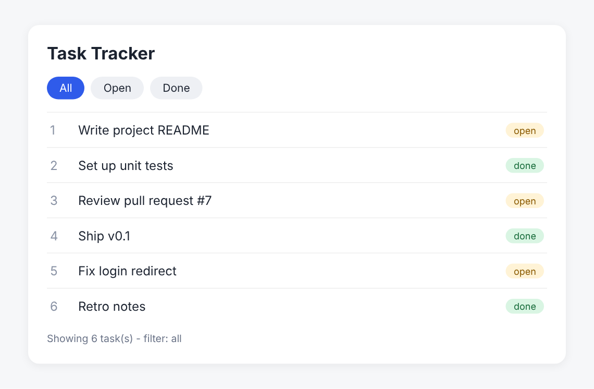
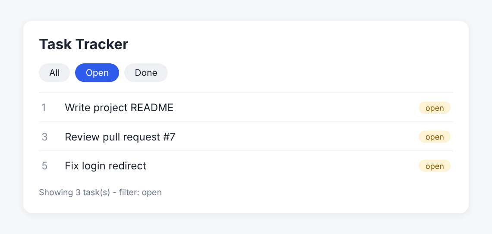
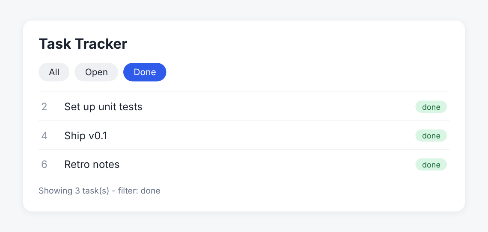

<div align="center">

# 🤖 AI Coding Agents — Intern Handbook

### Complete hands-on code pack: from "what is a coding agent?" to an evidence-backed PR handoff


**Author:** [Mirza Yasir Abdullah Baig](https://github.com/mirzayasirabdullahbaig07)

</div>

---

## 📖 About

This repository turns the **AI Coding Agents — Intern Handbook** (Task Tracker learning path) into working, tested code.
Every handbook page is one task, and every task is a **self-contained folder** with its own:

- 🧩 **Source code**: a small, readable implementation of the page's idea
- ✅ **Unit tests**: `python -m unittest`
- ▶️ **Demo script**: `python demo.py` prints real output
- 📸 **Screenshots**: code, test run and demo output
- 📄 **PDF report**: concept, code, screenshots and an evidence-backed summary

Everything uses the **Python standard library only**. There is nothing to install.

---

## 🗂️ Tasks

| # | Folder | Handbook topic | What you build |
|:-:|--------|----------------|----------------|
| 01 | [`task-01-coding-agent-basics`](task-01-coding-agent-basics) | Suggestion vs verified result | Evidence recorder + claim judge (VERIFIED / FAILED / BLOCKED / NOT VERIFIED) |
| 02 | [`task-02-llm-context-memory`](task-02-llm-context-memory) | LLM, context & memory | 6-field context packet, secret scanner, token-budget file selector |
| 03 | [`task-03-agent-working-loop`](task-03-agent-working-loop) | The agent working loop | Propose → policy → execute → observe → adjust → verify loop on a real bug |
| 04 | [`task-04-orchestration-layer`](task-04-orchestration-layer) | Orchestration layer | Permissions, bounded retries, timeouts, checkpoints, audit log |
| 05 | [`task-05-multi-agent-systems`](task-05-multi-agent-systems) | Multi-agent systems | Delegation contract, task graph, file-conflict detection |
| 06 | [`task-06-ai-communication`](task-06-ai-communication) | Communicating with AI | Prompt builder + Weak / Better / Strong grader + templates |
| 07 | [`task-07-repo-daily-workflow`](task-07-repo-daily-workflow) | Daily repo workflow | Real `git` preflight, safe branching, diff scope check, exact-revision handoff |
| 08 | [`task-08-debugging-review-evidence`](task-08-debugging-review-evidence) | Debugging, review & evidence | Reproduce → hypothesis → fix → regression check → evidence report |
| 09 | [`task-09-safety-privacy-efficiency`](task-09-safety-privacy-efficiency) | Safety, privacy & efficiency | Secret redaction, prompt-injection guard, escalate-vs-continue rules, budgets |
| 10 | [`task-10-practice-lab`](task-10-practice-lab) | Practice lab | Task Tracker **status filter** + bug diagnosis + PR handoff + 5-point rubric |

---

## 📁 Repository structure

```text
ai-coding-agents-handbook/
├── README.md
├── run_all.py                      # run every task's tests
├── requirements-tools.txt          # only for regenerating screenshots / PDFs
├── .github/workflows/ci.yml        # GitHub Actions: tests on every push / PR
├── tools/                          # screenshot + PDF report generators
├── task-01-coding-agent-basics/
│   ├── evidence.py                 # implementation
│   ├── test_evidence.py            # unit tests
│   ├── demo.py                     # runnable demo
│   ├── report.pdf                  # PDF report for this task
│   ├── screenshots/                # code + demo screenshots
│   └── README.md
├── task-02-llm-context-memory/     # same layout
├── ...
└── task-10-practice-lab/           # full Task Tracker app, tests, handoff, rubric
```

---

## 🚀 Quick start

```bash
# 1. Clone
git clone https://github.com/mirzayasirabdullahbaig07/<repo-name>.git
cd <repo-name>

# 2. Run every task's tests
python run_all.py

# 3. Run a single task's demo
cd task-03-agent-working-loop
python demo.py
```

**Requirements:** Python 3.9 or newer. No `pip install` needed.

---

## 🧪 Task Tracker practice lab (Task 10)

```bash
cd task-10-practice-lab

python -m task_tracker list                    # all tasks (existing behaviour preserved)
python -m task_tracker list --status open      # only open tasks
python -m task_tracker list --status done      # only done tasks

python -m unittest discover -s tests -v        # 15 tests: acceptance, negative, regression, CLI
python diagnose_bug.py                         # reproduce → hypothesis → fix → verify
python generate_handoff.py                     # writes PR_HANDOFF.md from real test results
python rubric_check.py                         # 5-point rubric self-check
```

| All | Open | Done |
|:---:|:---:|:---:|
|  |  |  |

---

## 🧠 Key ideas from the handbook

- **Delegate work, not accountability.** Always keep scope + evidence + human judgement together.
- **Propose ≠ execute.** A command only counts once there is an observable result.
- **Context should be relevant, current and bounded.** More text does not mean better context.
- **The model proposes; the orchestration layer controls.** Permissions, retries and state live outside the prompt.
- **More agents are not automatically better.** Delegate only when boundaries are clear.
- **Strong prompts are measurable:** Goal → Context → Scope → Constraints → Acceptance → Verification → Response.
- **Evidence belongs to an exact revision.** Local pass, CI pass, merged and deployed are different states.
- **Passing tests are evidence, not proof of everything.**
- **Stop and escalate** when authority or information is missing.

---

## 📸 Screenshots and reports

Each task folder contains `screenshots/` (code, tests, demo output) and a `report.pdf` with:
concept → what was built → behaviours demonstrated → code screenshots → demo screenshots → evidence-backed report (revision, checks run, results, checks not run, limitations, next action).

To regenerate them:

```bash
pip install -r requirements-tools.txt
python -m playwright install chromium
python tools/make_screenshots.py
python tools/make_reports.py
```

---

## ✅ Continuous integration

`.github/workflows/ci.yml` runs `python run_all.py` on Python 3.9, 3.11 and 3.13 for every push and pull request.

---

## 👤 Author

**Mirza Yasir Abdullah Baig**
GitHub: [@mirzayasirabdullahbaig07](https://github.com/mirzayasirabdullahbaig07)

---

<div align="center">

⭐ If this helped you learn how to work with AI coding agents, consider giving the repo a star.

</div>
